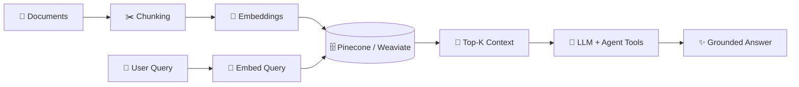

<!-- ═══════════════════════════ HEADER ═══════════════════════════ -->


<div align="center">

<a href="https://git.io/typing-svg">
  
</a>

<br/>

<a href="https://linkedin.com/in/ram-mohan-dixit-817a6a224"></a>
<a href="mailto:ramodixit76@gmail.com"></a>
<a href="https://leetcode.com/codex_156"></a>


</div>


## 🧬 `$ whoami`

```typescript
const ramMohan = {
  role:        "Full-Stack Engineer 🛠️  ×  AI Builder 🤖",
  basedIn:     "India 🇮🇳",
  education:   "M.Tech — AI & Data Science @ IIT Patna",
  currently:   "Building RAG pipelines & agentic AI @ Geeta University",
  experience:  "2+ years of shipping, breaking, fixing, repeat 🔁",
  impact:      "Products used by 1,000+ real humans",

  obsessedWith: ["System Design", "RAG Pipelines", "Agentic Workflows", "Scalable Backends"],
  sideQuest:    "Mentoring devs in React, Node.js & applied AI 👨‍🏫",

  fuel:        ["☕ chai", "🎧 lo-fi", "🐛 stubborn bugs"],
  motto:       "Build products that solve real problems.",

  hire() {
    return "📩 ramodixit76@gmail.com — let's build something legendary.";
  },
};
```


## 🛠️ Arsenal

<div align="center">

<br/>
<br/>


</div>

<br/>

| ⚔️ Domain | 🔧 Weapons of Choice |
|:--|:--|
| 🎨 **Frontend** |       |
| ⚙️ **Backend & Data** |       |
| 🧠 **AI & ML** |        |
| ☁️ **Cloud & DevOps** |      |


## 🚀 Things I've Shipped

<table>
<tr>
<td width="33%" valign="top">

### 🤖 AI Internal Tools
`LangChain` `OpenAI` `Vector DBs`

RAG pipelines + agentic workflows that read, reason, and review so faculty don't have to.

**📉 ~50% less** content-review time

</td>
<td width="33%" valign="top">

### 🎓 Code For Mode
`MERN` `Socket.io` `Cloudinary`

Full EdTech platform: real-time code execution, auto-grading, live classes, JWT auth & community chat.

**⚡ Learn → Code → Get graded**

</td>
<td width="33%" valign="top">

### 🏢 Kodu ERP
`AWS` `Redis` `MongoDB` `RBAC`

High-concurrency ERP with secure APIs, role-based access, smart indexing & caching.

**🛡️ 35+ APIs · 99.9% uptime**

</td>
</tr>
</table>

<details>
<summary><b>🔍 Peek inside: how my RAG pipelines think (click me)</b></summary>
<br/>



</details>


## 📊 The Numbers Don't Lie

<div align="center">


<br/><br/>


</div>

## 🐍 Watch the Snake Eat My Commits

<div align="center">
<picture>
  <source media="(prefers-color-scheme: dark)" srcset="https://raw.githubusercontent.com/ramo74dixit/ramo74dixit/output/github-contribution-grid-snake-dark.svg" />
  
</picture>
</div>

## 🎮 Current Status

```diff
+ 🟢 Online      → building agentic AI systems
+ 🟢 Learning    → advanced RAG evals & multi-agent orchestration
+ 🟢 Open to     → cool collabs, AI products, mentoring
- 🔴 Not doing   → shipping code without tests (anymore 😅)
! 🟡 Loading...  → the next big thing
```

<div align="center">

### 💬 *"Build products that solve real problems."*


</div>


