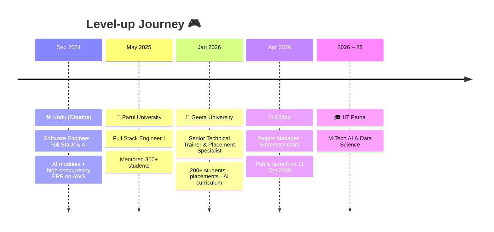
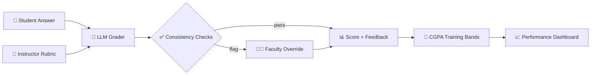

<!-- ═══════════════════════════ BOOT SEQUENCE ═══════════════════════════ -->


<div align="center">


<br/>

<a href="https://www.linkedin.com/in/rd82/"></a>
<a href="mailto:ramodixit76@gmail.com"></a>
<a href="https://leetcode.com/u/codex_156/"></a>
<a href="https://www.geeksforgeeks.org/profile/ramodixit577"></a>


</div>


## 🎮 Player Profile

<table>
<tr>
<td width="55%" valign="top">

```yaml
player:      Ram Mohan
class:       🧙 AI Trainer × ⚔️ Full-Stack Engineer
guild:       Geeta University · Senior Technical Trainer
academy:     IIT Patna · M.Tech AI & Data Science (2026–28)
side_quest:  Project Manager @ E2Job 🚀

special_abilities:
  - Turns confused students into hired devs 🎯
  - Teaches LLMs to grade like professors 🧠
  - Explains hard things, one step at a time 🪜
  - Ships to prod on a free-tier budget 💸

alignment:   "Build products that solve real problems."
```

</td>
<td width="45%" valign="top">

### 📈 Character Stats

```text
🧑‍🏫 Teaching      ██████████  MAX
🧠 Gen-AI / LLMs  █████████░  90
⚙️ Backend        █████████░  90
🎨 Frontend       ████████░░  80
☁️ DevOps         ███████░░░  70
📋 Leadership     ████████░░  80
☕ Chai Intake    ██████████  ∞
```

</td>
</tr>
</table>


## 🏆 Achievements Unlocked

<div align="center">

| 🎓 | 🧑‍💻 | 🚀 | 🛡️ | 💰 |
|:--:|:--:|:--:|:--:|:--:|
| **500+** | **5,000** | **11 Oct 2026** | **99.9%** | **60%** |
| learners trained | students load-tested | E2Job public launch | ERP uptime | storage cost cut |

</div>


## 🗺️ The Campaign So Far



<details>
<summary><b>📜 Open the full quest log</b></summary>
<br/>

**🎯 Senior Technical Trainer & Placement Specialist** · *Geeta University* · `Jan 2026 – Present`
> Training 200+ students in programming, full-stack and AI integration with LLM APIs. Designed curriculum on Python, DSA, prompt engineering and RAG. Rubric-based code reviews, mock interviews, resume reviews and campus drives with recruiters.

**🚀 Project Manager** · *E2Job — AI-enabled Jobs & Assessment Platform* · `Apr 2026 – Present`
> Led backend, infra, frontend and QA to public launch on free-tier cloud. Load-tested for 5,000 students, enforced PR reviews and QA sign-off. Built the employer side and a white-label university product with a proctored MBA assessment portal.

**🏫 Full Stack Engineer I** · *Parul University* · `May 2025 – Dec 2025`
> Mentored 300+ students on programming, system design and AI-assisted development. Live sessions on REST APIs, reusable components and Docker/CI/CD deployments.

**🛠️ Software Engineer (Full Stack & AI)** · *Kodu – Powered by Dhurina* · `Sep 2024 – May 2025`
> Integrated AI-driven personalisation into an ed-tech platform. Optimized MongoDB schemas and REST APIs for high concurrency; managed AWS deployment.

</details>


## 🧰 Inventory

<div align="center">

<br/>
<br/>


</div>

<br/>

| 🎒 Slot | 🗡️ Equipped |
|:--|:--|
| 🧠 **Gen-AI & LLMs** |        |
| 🔌 **LLM Platforms & Vector DBs** |        |
| 🔬 **ML & Data** |        |
| 🌐 **Web** |        |
| ☁️ **Data & Cloud** |        |
| 🧑‍🏫 **Trainer Perks** |       |


## ⚔️ Boss Fights Won

<table>
<tr>
<td width="50%" valign="top">

### 🧠 E2Job AI Assessment Portal
`LLM APIs` `Prompt Engineering` `MERN`

**The boss:** grading hundreds of descriptive MBA answers by hand.
**The move:** an LLM grading pipeline scoring answers against instructor rubrics, with consistency checks and a manual override for faculty.
**The loot:** CGPA-based training bands + performance dashboards.

</td>
<td width="50%" valign="top">

### 🏢 Kodu ERP
`MERN` `AWS` `Redis` `Cloudinary`

**The boss:** high-concurrency traffic on a tight budget.
**The move:** 35+ secure RBAC APIs, custom validation middleware, smart MongoDB indexing.
**The loot:** 🛡️ 99.9% uptime · 💰 60% lower storage cost · ⚡ 30% faster queries for 100+ active users.

</td>
</tr>
</table>

<details>
<summary><b>🔍 X-ray: how the AI grader thinks</b></summary>
<br/>



</details>


## 📊 Scoreboard

<div align="center">


</div>

## 🐍 Final Boss: The Commit Snake

<div align="center">
<picture>
  <source media="(prefers-color-scheme: dark)" srcset="https://raw.githubusercontent.com/ramo74dixit/ramo74dixit/output/github-contribution-grid-snake-dark.svg" />
  
</picture>
</div>

## 💾 Save File

```diff
+ 🟢 Currently   → training devs @ Geeta University & shipping E2Job
+ 🟢 Studying    → M.Tech AI & Data Science @ IIT Patna
+ 🟢 Exploring   → LLM evaluation, agents, LoRA & RLHF
+ 🟢 Open to     → AI products, collabs, mentoring, speaking at workshops
- 🔴 Never       → pushing to prod without QA sign-off
! 🟡 Next level  → loading...
```

<div align="center">

### 💬 *"Build products that solve real problems — and teach others to do the same."*


</div>


